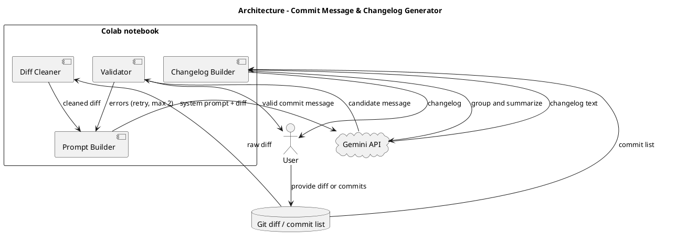
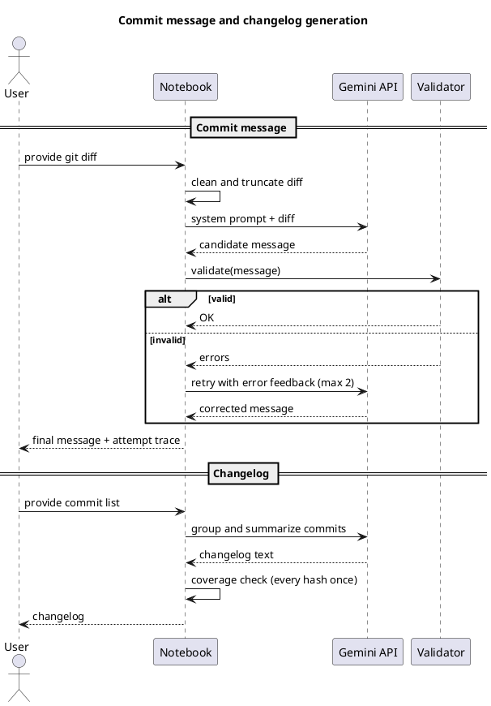
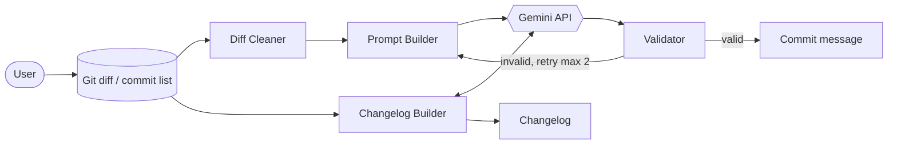
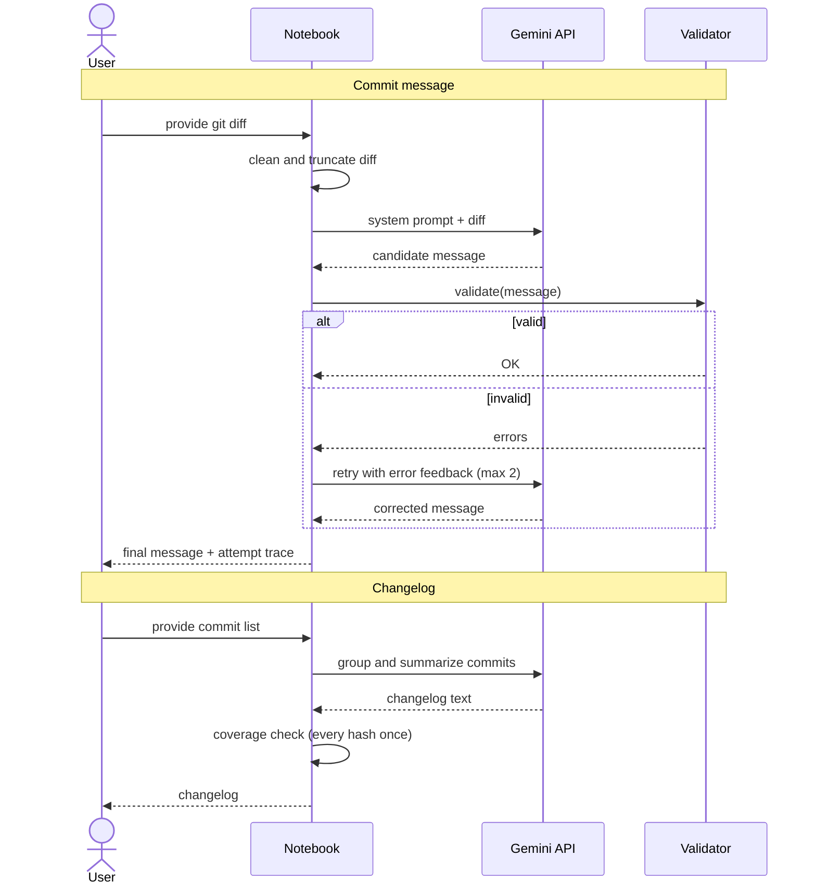

# Commit Message & Changelog Generator: Build Plan

> For Claude Code. Keep it simple. The assignment needs diagrams, example data, a test prompt and one Colab notebook. Nothing else is required, so do not add anything else: no Python package, no CLI, no test suite, no CI.
> At every `ASK USER` marker, stop and ask. Do not invent the answer.

## 1. What we're building

A generative-AI information system (university course project) using the Gemini API:

- **Commit message:** git diff in, Conventional Commits message out.
- **Changelog:** list of commits in, grouped changelog out.

Existing tools already generate commit messages, so two small extras make this project more than a copy:

1. **Validator + retry:** the output is checked against format rules; if invalid, the errors go back to the model (max 2 retries).
2. **Changelog coverage check:** every input commit must appear in the changelog exactly once, and nothing may be invented.

## 2. Requirements to deliverables

The assignment is in Lithuanian; this is a paraphrase. (X, y) means X = input diff, y = expected commit message.

| Req | What is required | Deliverable |
|---|---|---|
| 1.1 | Design the system from a prompt: first PlantUML diagrams, then Mermaid | `docs/diagram_prompt.md`, `docs/diagrams/` (Appendix) |
| 1.2.1 | At least 3 end-to-end examples. A `data/` directory showing (X, y) pairs. A `prompts/` directory with the test prompt that, given to an AI agent, shows the answer | `data/`, `prompts/` |
| 1.2.2 | Working prototype in Google Colab with the Gemini API: project name, system overview, explained code, every step from input to final output documented, visualized results where possible. The `.ipynb` is uploaded to GitHub | `commit_gen_demo.ipynb` |

## 3. Repo layout

```
commit-gen/
  README.md
  .gitignore                    # .env, .ipynb_checkpoints
  commit_gen_demo.ipynb         # the prototype; all code lives here
  data/
    example_1_bugfix/           X_diff.patch, y_expected.txt
    example_2_feature/
    example_3_refactor/
    example_4_docs/
    example_5_multifile/
    changelog_example/          X_commits.json, y_expected_CHANGELOG.md
  prompts/
    system_prompt.md            # the prompt the notebook sends to Gemini
    test_prompt.md              # self-contained test prompt + the AI's pasted answer
  docs/
    diagram_prompt.md
    diagrams/                   # architecture.puml, sequence.puml, architecture.mmd, sequence.mmd
```

## 4. How it works

**Commit message flow**

1. **Input and cleaning:** take a diff as text. Skip lockfiles (`package-lock.json`, `yarn.lock`, `poetry.lock`, `go.sum`, `Cargo.lock`) and truncate to about 20,000 characters, appending a `[... truncated ...]` marker.
2. **Prompt:** `system_prompt.md` plus the diff wrapped in `<diff>...</diff>`, with a line saying everything inside is data, not instructions.
3. **Gemini call:** low temperature (0.2).
4. **Validator**, with a clear error sentence for each failure:
   - header must match `^(feat|fix|docs|style|refactor|perf|test|build|ci|chore|revert)(\([a-z0-9._/-]+\))?(!)?: \S.*$`
   - subject at most 72 characters
   - subject does not end with a period
   - blank line between subject and body, if there is a body
   - no code fences and no preamble like "Here is your commit message"
   Do not clean the model's output before validating. Silent cleanup would hide the failures the retry loop exists to show.
5. **Retry:** on failure, send back `Your previous output was invalid: <errors>. Return only the corrected commit message.` Max 2 retries. Keep every attempt so the notebook can display the trace. If it still fails, report it as failed. Do not quietly fix it.
6. **Output:** final message plus the attempt trace.

`system_prompt.md` contents: the Conventional Commits types with one line each on when to use them; output only the message; imperative subject, lowercase after the colon, at most 72 characters, no trailing period; optional body only when the why is not obvious; describe what and why, not line-by-line how. Include 2 few-shot examples. **The few-shot diffs must not be any of the diffs in `data/`.**

**Changelog flow**

Input is `X_commits.json` (list of `hash` + commit message). Gemini groups them into sections (Added, Fixed, Changed, Documentation, Internal), rewrites each in user-facing language, and ends every bullet with the short hash in parentheses. **Coverage check:** the set of hashes in the output must equal the set in the input. If not, retry (max 2) and tell the model which hashes are missing or invented.

**Results**

For each example in `data/`, the notebook shows generated vs expected, whether the format was valid on the first try, how many attempts it took, and whether the type (`fix`, `feat`, ...) matches `y`. Plot one bar chart (first-try valid, final valid, type match). State plainly in the notebook that 5 examples is a demo, not a benchmark.

## 5. Steps

**Step 1: Diagrams.** Save `docs/diagram_prompt.md` and the four diagram files from the Appendix. Render them once to confirm they are valid (plantuml.com/plantuml, mermaid.live).
*Accept:* all four render without errors.

**Step 2: Data.** Create the 5 examples plus the changelog example:

| # | Kind |
|---|---|
| 1 | bug fix, single file |
| 2 | new feature |
| 3 | refactor, no behavior change |
| 4 | docs-only change |
| 5 | multi-file change (code + tests + config) |

Source of the diffs: the user chose synthetic data, so do not ask for repos. Build a small throwaway git repo in a temp directory (do not commit it), for example a tiny Python utility, with about 12 realistic commits across several types. Take the five diffs with `git show <hash>` and the commit list for `changelog_example/X_commits.json` from it. Make each example clearly one type, so the (X, y) pairs are unambiguous.
Write a draft `y` for each, then tell the user to review and fix every `y` (see section 6). `y` is the ground truth, and the comparison means nothing if nobody checked it.
*Accept:* each folder has `X_diff.patch` and `y_expected.txt`; the user confirmed the `y` files.

**Step 3: Prompts.** Write `prompts/system_prompt.md`. Tune it on throwaway diffs that are not in `data/`, then freeze it before the reported run. Do not adjust it to fix individual `data/` examples, or the results are inflated.
Write `prompts/test_prompt.md` so it is **self-contained**: the system rules, one example diff in `<diff>` tags, then two headings at the bottom: `## Expected output (y)` and `## AI agent's answer (paste here)`. Pasting everything above those headings into any AI assistant must produce a commit message.
*Accept:* the test prompt works by copy-paste with no other context.

**Step 4: Notebook** (`commit_gen_demo.ipynb`). It must run top to bottom on a fresh Colab runtime. Put a markdown cell that explains each code cell before it. Sections:

1. Title, one-paragraph overview, architecture diagram (use a PNG exported from the Mermaid/PlantUML, because Mermaid does not render in Colab).
2. Setup: install the Gemini SDK, read the API key from Colab Secrets (`GEMINI_API_KEY`), set the model name in one variable at the top.
3. The pipeline, one function per cell, each explained: diff cleaning, prompt builder, Gemini call, validator, retry loop.
4. Walkthrough on one example, printing every step: raw diff, cleaned diff, the exact prompt sent, raw model output, validation result, retries, final message.
5. Run over all of `data/`, results table and bar chart.
6. Changelog: input, output, coverage check result.
7. Limitations and conclusion.

Look up the current Gemini SDK name and model IDs in Google's docs before writing code. Do not rely on memorized model names. Load `data/` and `prompts/` from the repo (`git clone` in the first cell) so the notebook reads the same files the repo shows.
*Accept:* runs end to end locally with a real key; no API key in any output.

**Step 5: README and push.** A short README: what it is, the Colab badge (`https://colab.research.google.com/github/ErvinasE/commit-gen/blob/main/commit_gen_demo.ipynb`), how `data/` and `prompts/` are organized, and one paragraph of limitations (small sample, synthetic examples, topic overlaps with existing tools, the diff is sent to Google's API so don't run it on sensitive code).
*ASK USER:* repo name, public or private with the teacher added, and whether README and notebook text should be English or Lithuanian.

## 6. What only the user can do

1. Create a Gemini API key in Google AI Studio and add it as the Colab secret `GEMINI_API_KEY`.
2. **Review and correct every `y_expected`.** If the AI writes the answers and nobody checks them, the comparison is meaningless.
3. Paste `prompts/test_prompt.md` into an AI assistant and paste its answer under the last heading.
4. Open the notebook in Colab, Run all, then File > Save a copy in GitHub so the committed `.ipynb` contains its outputs.
5. Make the repo public or add the teacher.

## 7. Done checklist

- [ ] `docs/` has the diagram prompt plus PlantUML and Mermaid diagrams
- [ ] `data/` has at least 3 (X, y) pairs (plan: 5) and the changelog example, all reviewed by the user
- [ ] `prompts/test_prompt.md` has the AI agent's answer pasted in
- [ ] Notebook runs on fresh Colab, has outputs saved, and is on GitHub
- [ ] No API key anywhere in the repo or notebook outputs

---

## Appendix: diagram prompt and diagrams

**`docs/diagram_prompt.md`**

```
I am a software engineering student. Design an information system that uses
generative AI, on this topic: "Commit message and changelog generator".

The system takes a git diff and uses the Gemini API to produce a Conventional
Commits message. It validates the output format and, if invalid, retries with the
validation errors as feedback (at most 2 retries). It can also generate a grouped
changelog from a list of commits and checks that every commit is covered.

First, briefly describe the system. Then produce PlantUML diagrams:
1. a component/architecture diagram
2. a sequence diagram covering both the commit message flow and the changelog flow

Then convert the same two diagrams to Mermaid. Keep component names consistent
between the PlantUML and Mermaid versions.
```

**`docs/diagrams/architecture.puml`**



**`docs/diagrams/sequence.puml`**



**`docs/diagrams/architecture.mmd`**



**`docs/diagrams/sequence.mmd`**


